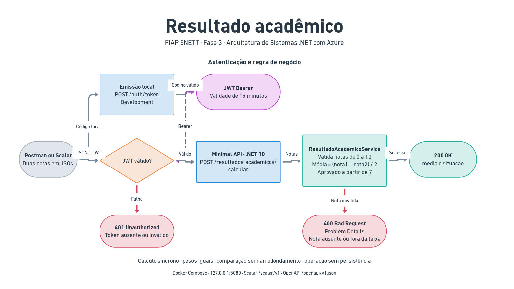
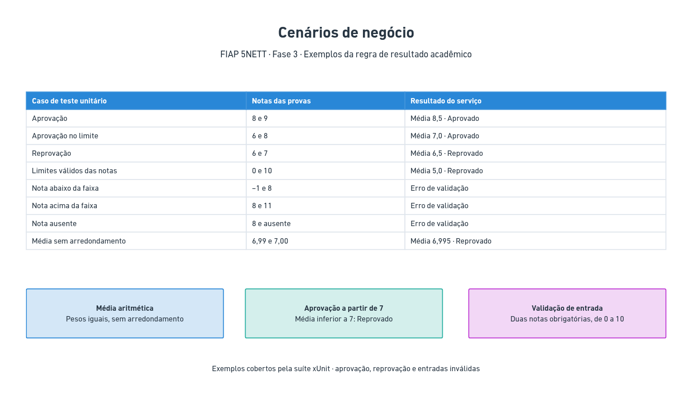

# FIAP 5NETT — Fase 3

API de resultado acadêmico desenvolvida para o Tech Challenge da **Pós Tech em Arquitetura de Sistemas .NET com Azure — FIAP 5NETT**. A aplicação calcula a média de duas provas e informa a situação do aluno, com autenticação JWT, documentação interativa e evidências de qualidade no GitHub Actions.

[](https://github.com/robertishimurasousa/Fiap-Pos-Tech-5NETT-Fase3/actions/workflows/dotnet-ci.yml)

[Arquitetura](#arquitetura) · [Executar localmente](#executar-localmente) · [Postman](#testar-no-postman) · [Testes](#executar-a-suíte) · [Relatórios e CI](#github-actions-e-evidência-para-a-fiap) · [Vídeo e PDF](#demonstração-em-vídeo) · [Licença](#licença)

## Arquitetura

### Fluxo da API



O endpoint HTTP recebe as notas e traduz erros de validação em Problem Details. O `ResultadoAcademicoService` concentra a regra de cálculo e pode ser testado sem servidor HTTP. A configuração JWT valida a assinatura, o emissor, a audiência e a validade do token. O Scalar utiliza o contrato OpenAPI da própria API.

O recorte é um serviço síncrono, sem persistência ou dependências externas de negócio. A separação entre transporte, autenticação e regra de cálculo aplica os princípios de responsabilidade única e testabilidade vistos na Fase 3. A estrutura permanece proporcional ao tamanho da atividade.

### Fluxo de qualidade contínua


O workflow executa três jobs em paralelo: testes .NET com cobertura e Allure, smoke HTTP em Docker e coleção Postman contra uma API Docker isolada. O Postman obtém o JWT automaticamente, verifica oito requisições com 17 asserções e produz um relatório JUnit, além de enviar o resultado à conta Postman. O Qodana possui um workflow próprio para análise estática. Os resultados convergem para a revisão e o merge; o tracejado roxo identifica essa dependência da análise estática.

O painel ilustra as validações dos pull requests. Na `main`, a CI também chama o workflow Qodana e aguarda os quatro validadores antes de publicar a imagem no GHCR, conforme a seção de publicação abaixo.

### Cenários de negócio



A tabela reúne exemplos cobertos pelos testes da regra de cálculo. O painel destaca a média sem arredondamento, a aprovação a partir de 7 e a obrigatoriedade de duas notas entre 0 e 10.

As três imagens são exportações do desenho de arquitetura e podem ser consultadas neste repositório, sem acesso a ferramentas externas.

Arquivos individuais para documentos ou apresentações: [API](docs/images/fluxo-api.png) · [Qualidade contínua](docs/images/fluxo-ci.png) · [Cenários de negócio](docs/images/cenarios-negocio.png).

## Regra de negócio e contrato HTTP

- As duas notas são obrigatórias e devem estar entre **0 e 10**, inclusive.
- A média tem pesos iguais: `(nota1 + nota2) / 2`.
- A comparação ocorre **sem arredondamento**. Média maior ou igual a **7** resulta em `Aprovado`; abaixo disso, `Reprovado`.

Por exemplo, `6` e `8` produzem média `7` e aprovação. Já `6.99` e `7.00` produzem média `6.995` e reprovação.

| Método e rota | Finalidade | Respostas principais | Acesso |
| --- | --- | --- | --- |
| `POST /auth/token` | Emitir JWT de demonstração a partir do campo `codigo` | `200` com token; `401` para código incorreto | Apenas Development |
| `POST /resultados-academicos/calcular` | Calcular a média e a situação | `200` com resultado; `400` para notas inválidas; `401` para token ausente ou inválido | Bearer JWT |
| `GET /scalar/v1` | Consultar e experimentar a API | `200` com documentação interativa | Apenas Development |
| `GET /openapi/v1.json` | Consultar o contrato OpenAPI | `200` com o documento JSON | Apenas Development |

Exemplo de entrada do cálculo:

```json
{"nota1": 6, "nota2": 8}
```

Resposta HTTP `200`:

```json
{"media": 7, "situacao": "Aprovado"}
```

## Executar localmente

Pré-requisitos: Docker com Compose **ou** SDK .NET 10, além de OpenSSL para o comando abaixo. O SDK compatível está definido em [`global.json`](global.json).

O modelo [`.env.example`](.env.example) documenta as variáveis da API e a porta local. Para criar o `.env` na raiz com dois valores aleatórios independentes já preenchidos, execute este comando uma vez em um clone novo:

```sh
(umask 077; set -C; printf 'ESCOLA_JWT_CHAVE=%s\nESCOLA_JWT_CODIGO=%s\n' "$(openssl rand -hex 32)" "$(openssl rand -hex 32)" > .env)
```

O `.env` é local e está ignorado pelo Git. `ESCOLA_JWT_CHAVE` assina os tokens; `ESCOLA_JWT_CODIGO` permite obtê-los no ambiente educacional de demonstração. A emissão local fica disponível somente em Development.

### Com Docker Compose

```sh
docker compose up --build
```

O Compose inicia a API em Development e publica a porta 5080 no endereço local `127.0.0.1`. Os links da emissão de token, da API, do Scalar e do OpenAPI aparecem nos logs junto com o horário de início em São Paulo.

Para iniciar em outra porta, use `ESCOLA_PORTA_LOCAL=5081 docker compose up --build`. Para remover o container e a rede da aplicação, execute `docker compose down`.

### Com o SDK .NET

As duas opções usam a porta 5080. Encerre a primeira execução antes de iniciar a outra.

```sh
. ./.env
ASPNETCORE_ENVIRONMENT=Development \
  Jwt__ChaveAssinatura="$ESCOLA_JWT_CHAVE" \
  Jwt__CodigoAcesso="$ESCOLA_JWT_CODIGO" \
  dotnet run --project src/Escola.Api -- --urls http://127.0.0.1:5080
```

Após iniciar a API em Development, abra `http://127.0.0.1:5080/scalar/v1` para consultar e testar a operação. O documento OpenAPI fica em `http://127.0.0.1:5080/openapi/v1.json`. Esses endereços funcionam na máquina em que a API está rodando.

### Autenticar e calcular

1. No Scalar, execute `POST /auth/token` com um JSON cujo campo `codigo` contém o valor de `ESCOLA_JWT_CODIGO` do arquivo `.env`.
2. Copie o `accessToken` da resposta para a autenticação Bearer do Scalar. O token dura 15 minutos. A emissão local só está disponível em Development.
3. Execute `POST /resultados-academicos/calcular` com as duas notas. Para usar o terminal, defina a variável `TOKEN` com o token emitido e rode:

```sh
curl -i http://127.0.0.1:5080/resultados-academicos/calcular \
  -H "Authorization: Bearer $TOKEN" \
  -H 'Content-Type: application/json' \
  -d '{"nota1":6,"nota2":8}'
```

O exemplo retorna HTTP `200` com média `7` e situação `Aprovado`. Com uma nota ausente ou fora de 0 a 10, a API retorna HTTP `400` com Problem Details. Um token ausente, inválido ou expirado recebe HTTP `401`.

## Testar no Postman

1. Inicie a API com `docker compose up --build`.
2. No Postman Desktop, clique em **Import** e selecione a [coleção](postman/fiap-5nett-fase-3.postman_collection.json) e o [ambiente](postman/fiap-5nett-local.postman_environment.json).
3. Selecione **FIAP 5NETT — Local**. Preencha o valor **local** de `codigoAcesso` com `ESCOLA_JWT_CODIGO` do `.env`. A `baseUrl` já aponta para a porta 5080. Se a API estiver em outra porta, ajuste também o valor local de `baseUrl`.
4. Envie **Obter token JWT**. O script guarda `accessToken` no ambiente, e as requisições protegidas usam esse valor automaticamente. Emita um novo token após 15 minutos.
5. Envie uma requisição de cálculo e confira **Test Results**. Para executar todos os casos, abra a coleção e escolha **Run collection** com o mesmo ambiente. Mantenha **Obter token JWT** como primeira requisição.

Para rodar a mesma coleção no terminal interno do Postman Desktop ou com o [Postman CLI independente](https://learning.postman.com/docs/postman-cli/postman-cli-installation), use Python 3.9+ na raiz:

```sh
python3 postman/run.py
python3 postman/run.py --porta 5081
```

O runner lê o código do `.env`, monta um ambiente temporário para o endereço local e o remove ao terminar. A chave de assinatura fica com a API.

## Executar a suíte

Na raiz do repositório, com o SDK .NET 10:

```sh
dotnet restore Escola.slnx
dotnet format Escola.slnx --verify-no-changes --no-restore
dotnet build Escola.slnx --configuration Release --no-restore -warnaserror
dotnet test Escola.slnx --configuration Release
```

Os testes configuram as próprias credenciais de demonstração. A suíte usa **xUnit** e cobre a regra de negócio, os contratos HTTP, a autenticação e a inicialização da aplicação. Os testes HTTP executam a API em memória com `WebApplicationFactory` e `TestServer`.

## GitHub Actions e evidência para a FIAP

O workflow [**Testes e cobertura .NET**](.github/workflows/dotnet-ci.yml) verifica a formatação C#, compila com warnings tratados como erros e executa as suítes xUnit unitária e HTTP. O job separado de Docker compila a imagem e verifica a resposta `401` sem token e o cálculo autenticado com resposta `200`, média `7` e situação `Aprovado`.

O workflow [**Qodana**](.github/workflows/qodana_code_quality.yml) analisa `Escola.slnx` com o linter Community para .NET. Em pushes na `main`, ele é reutilizado pela CI para que a publicação dependa da análise da mesma revisão. Em pull requests e pushes em `rob-*` ou `releases/*`, continua executando como workflow próprio. Ambos mantêm acionamento manual. As branches temporárias seguem o padrão `rob-<número>-<assunto>`. O Qodana envia a análise ao projeto configurado no Qodana Cloud; o resultado SARIF público pode ser consultado sem acesso ao Cloud.

### Coleção Postman na CI

O job **Postman HTTP em Docker** instala o Postman CLI e autentica com a secret de repositório `POSTMAN_API_KEY`. Executa a coleção e o ambiente salvos no Postman, pelos IDs configurados no workflow. A URL, o código de demonstração e o token inicial são sobrescritos apenas para a execução; o ambiente salvo permanece intacto. A API usa uma porta de loopback disponível e credenciais temporárias, e o container é removido ao terminar.

Ao recriar uma coleção ou um ambiente, publique os recursos no Postman Cloud e atualize seus IDs no workflow. No modo Native Git do Postman Desktop, os IDs locais podem ser diferentes dos IDs do Cloud; confira o mapeamento `cloudResources` em `.postman/resources.yaml` após o **Push to Postman Cloud**. A CI usa os IDs do Cloud, e um `git push` não publica os recursos no Postman.

A coleção obtém o JWT e o reutiliza nos cálculos. Seus oito cenários verificam aprovação, reprovação, entradas inválidas e autenticação. Falhas de asserção reprovam o job. O resultado é enviado ao Postman, e o artefato **relatorio-postman** disponibiliza `results.xml` no formato JUnit no Actions, inclusive quando há falha de teste.

O job roda em pushes e PRs do próprio repositório. PRs de forks e do Dependabot não executam esse job, pois não recebem a secret. O runner manual `postman/run.py` continua usando os arquivos versionados; a CI usa a versão da coleção salva no Postman. Mudanças nessa coleção podem alterar os testes executados pela CI.

### Imagem da API no GHCR

Após o merge, o push na `main` executa xUnit/cobertura, smoke Docker, Postman e Qodana. Somente após os quatro jobs aprovarem, **Publicar imagem no GHCR** constrói a imagem, executa o smoke, publica e repete o smoke usando o digest baixado do registro. Pull requests e branches de trabalho não publicam imagens.

O endereço da imagem conserva o nome da publicação inicial para manter os comandos de download e as revisões já publicadas. A CI usa essa referência estável mesmo após a renomeação do repositório para `Fiap-Pos-Tech-5NETT-Fase3`.

O pacote fica associado a este repositório em **Packages**, com a referência `ghcr.io/robertishimurasousa/fiap-pos-tech-dotnet-azure-fase3`:

| Referência | Uso |
| --- | --- |
| `main` | Última publicação aprovada que ainda correspondia à revisão atual da main |
| `sha-<SHA completo do commit>` | Identificar a revisão construída |
| `@sha256:<digest>` | Baixar o conteúdo exato validado no registro |

O resumo do job e o artefato **imagem-ghcr/image.json** registram as referências, revisão, plataforma e atualização da tag `main`. A plataforma publicada é **linux/amd64**; no Docker Desktop com Apple Silicon, os comandos abaixo usam essa plataforma por emulação.

A publicação usa `GITHUB_TOKEN`, com `packages: write` apenas no job responsável. Nenhuma credencial da API é incluída na imagem. O [pacote deste projeto](https://github.com/robertishimurasousa/Fiap-Pos-Tech-5NETT-Fase3/pkgs/container/fiap-pos-tech-dotnet-azure-fase3) está **público** e pode ser baixado sem login:

```sh
docker pull --platform linux/amd64 ghcr.io/robertishimurasousa/fiap-pos-tech-dotnet-azure-fase3:main
```

Para executar a imagem publicada, prepare o `.env` conforme a seção de execução local e libere a porta 5080:

```sh
. ./.env
Jwt__ChaveAssinatura="$ESCOLA_JWT_CHAVE" Jwt__CodigoAcesso="$ESCOLA_JWT_CODIGO" \
  docker run --rm --platform linux/amd64 \
    --publish 127.0.0.1:5080:8080 \
    --env ASPNETCORE_ENVIRONMENT=Development \
    --env Jwt__ChaveAssinatura --env Jwt__CodigoAcesso \
    ghcr.io/robertishimurasousa/fiap-pos-tech-dotnet-azure-fase3:main
```

As configurações e os endpoints do Postman continuam iguais. Para repetir uma revisão específica, use a tag por SHA ou o digest do artefato da execução. A visibilidade é gerenciada em **Packages**; se o pacote for tornado privado, será necessário autenticar o Docker com uma credencial que tenha `read:packages`.

### Relatórios para baixar

A [release de evidências públicas](https://github.com/robertishimurasousa/Fiap-Pos-Tech-5NETT-Fase3/releases/tag/evidencias-fase3-v2) oferece os relatórios da revisão identificada abaixo para **download sem login**:

| Download público | Conteúdo | Como consultar |
| --- | --- | --- |
| [cobertura-dotnet.zip](https://github.com/robertishimurasousa/Fiap-Pos-Tech-5NETT-Fase3/releases/download/evidencias-fase3-v2/cobertura-dotnet.zip) | HTML consolidado, XML Cobertura e resultados TRX | Extraia o ZIP e abra `coverage/index.html` |
| [relatorio-allure.zip](https://github.com/robertishimurasousa/Fiap-Pos-Tech-5NETT-Fase3/releases/download/evidencias-fase3-v2/relatorio-allure.zip) | Relatório navegável e resultados JSON dos testes | Extraia o ZIP e abra `allure-report/index.html` |
| [relatorio-postman.zip](https://github.com/robertishimurasousa/Fiap-Pos-Tech-5NETT-Fase3/releases/download/evidencias-fase3-v2/relatorio-postman.zip) | Oito requisições e 17 asserções no formato JUnit | Extraia o ZIP e consulte `results.xml` em um editor ou leitor JUnit |
| [qodana-sarif.zip](https://github.com/robertishimurasousa/Fiap-Pos-Tech-5NETT-Fase3/releases/download/evidencias-fase3-v2/qodana-sarif.zip) | SARIF curto original da análise estática | Extraia e consulte `qodana.sarif.json`; `runs[].results` contém os apontamentos |

O [resumo versionado](docs/evidencias/validacao.json) registra a revisão, execuções de origem, contagens e hashes dos pacotes. Para conferir a integridade, baixe também [validacao.json](https://github.com/robertishimurasousa/Fiap-Pos-Tech-5NETT-Fase3/releases/download/evidencias-fase3-v2/validacao.json) e [SHA256SUMS.txt](https://github.com/robertishimurasousa/Fiap-Pos-Tech-5NETT-Fase3/releases/download/evidencias-fase3-v2/SHA256SUMS.txt) na mesma pasta dos ZIPs e execute `shasum -a 256 -c SHA256SUMS.txt` no macOS ou `sha256sum -c SHA256SUMS.txt` no Linux.

Cada execução em [Actions](https://github.com/robertishimurasousa/Fiap-Pos-Tech-5NETT-Fase3/actions) continua publicando **Artifacts**: `cobertura-dotnet`, `relatorio-allure` e `relatorio-postman` no workflow .NET e `qodana-report` na análise Qodana, reutilizada pela CI da main. Após a publicação da imagem, há também `imagem-ghcr`. Esses downloads da pipeline exigem login no GitHub e estão sujeitos à retenção. A release preserva uma cópia pública dos arquivos de cobertura, Allure, JUnit Postman e SARIF curto original do Qodana, sem alterar os resultados.

O resumo da execução .NET também mostra a cobertura consolidada. Os logs do job **Smoke HTTP em Docker** registram a verificação da API no container.

O HTML do Allure é autocontido e mostra cenários, parâmetros, duração e resultado de cada teste. A pipeline também gera e publica o Allure quando uma suíte registra falhas.

Os cenários HTTP de resultado acadêmico apresentam as etapas de autenticação, envio e validação. Cada cenário anexa a entrada JSON e o corpo da resposta de cálculo ou Problem Details, junto com o status HTTP recebido.

### Referência validada

Resultados da revisão [`0902779`](https://github.com/robertishimurasousa/Fiap-Pos-Tech-5NETT-Fase3/commit/090277915f3073c18c8e62e1c8c3aa0e7e34f955), executada em `main` em 17/11/2026:

| Evidência | Resultado | Link |
| --- | --- | --- |
| xUnit | 48 testes aprovados: 12 unitários e 36 HTTP; nenhum ignorado | [Execução .NET](https://github.com/robertishimurasousa/Fiap-Pos-Tech-5NETT-Fase3/actions/runs/44197991680) |
| Cobertura | 159/159 linhas (100%) e 39/40 ramificações (97,5%) | [Download público da cobertura](https://github.com/robertishimurasousa/Fiap-Pos-Tech-5NETT-Fase3/releases/download/evidencias-fase3-v2/cobertura-dotnet.zip) |
| Allure | 48 resultados aprovados, com cenários, etapas e anexos | [Download público do Allure](https://github.com/robertishimurasousa/Fiap-Pos-Tech-5NETT-Fase3/releases/download/evidencias-fase3-v2/relatorio-allure.zip) |
| Postman | Oito requisições e 17 asserções aprovadas no job Docker | [Download público do JUnit](https://github.com/robertishimurasousa/Fiap-Pos-Tech-5NETT-Fase3/releases/download/evidencias-fase3-v2/relatorio-postman.zip) |
| Qodana | Zero apontamentos no SARIF da análise executada | [Execução Qodana](https://github.com/robertishimurasousa/Fiap-Pos-Tech-5NETT-Fase3/actions/runs/44197991803) · [SARIF público](https://github.com/robertishimurasousa/Fiap-Pos-Tech-5NETT-Fase3/releases/download/evidencias-fase3-v2/qodana-sarif.zip) |

Os números e os downloads da release são uma fotografia dessa revisão. Para alterações posteriores, consulte a execução correspondente. As evidências usam um commit identificado e permanecem consultáveis após a exclusão das branches temporárias.

Os relatórios preservam os metadados originais da execução, inclusive o nome usado pelo repositório naquele momento.

As 17 asserções Postman ficam no relatório JUnit. O Allure e a cobertura de código correspondem às suítes .NET, com 48 casos xUnit.

### Gerar o Allure localmente

Com Node.js 24 instalado, remova a pasta gerada `allure-results` antes de repetir a execução. Na raiz, execute:

```sh
dotnet test Escola.slnx --configuration Release -- xUnit.ReporterSwitch=allure
npx --yes allure@3.33.0 generate --clean
```

Abra `allure-report/index.html` no navegador. A configuração do gerador está em `allurerc.json`, e `tests/allureConfig.json` direciona as duas suítes para `allure-results`. O pacote `Allure.Xunit` usa o runner xUnit 2.8.2 por compatibilidade com a descoberta de reporters.

## Segurança

A [política de segurança](SECURITY.md) descreve as versões com manutenção e o canal privado do GitHub para relatar vulnerabilidades.

## Licença

O código e a documentação deste projeto estão disponíveis sob a [licença MIT](LICENSE), com copyright de 2026 de Robert Ishimura Sousa. A licença permite usar, modificar e redistribuir o projeto, inclusive comercialmente, mantendo o aviso de autoria e o texto da licença.

O projeto tem finalidade educacional; isso não acrescenta restrições à licença MIT. Dependências, imagens base e materiais de terceiros mantêm suas próprias licenças e direitos.

A imagem Docker inclui o arquivo em `/app/LICENSE` e o rótulo OCI `org.opencontainers.image.licenses=MIT`.

## Organização do código

```text
src/Escola.Api/
  Autenticacao/            Configuração, validação e emissão local de JWT
  ResultadosAcademicos/   Regra de cálculo e contratos de entrada e saída
  Program.cs              Composição da aplicação, rotas e OpenAPI
tests/
  Escola.UnitTests/       Testes da regra de negócio
  Escola.IntegrationTests/ Testes HTTP, autenticação e inicialização
postman/                  Coleção, ambiente e runner local
scripts/                  Smoke HTTP da API no Docker
docs/images/              Exportações dos fluxos do Whimsical
docs/evidencias/          Resumo e origem dos relatórios públicos
docs/entrega/             PDF de apresentação e links da entrega acadêmica
.github/workflows/        Testes, cobertura, Allure, Docker e Qodana
```

## Demonstração em vídeo

<iframe scrolling='no' frameborder='0' style='width: 1672px; height: 1080px; border:0;' src='https://app.screencast.com/sepbwjcUpLf23/e' allowfullscreen></iframe>

- [Assistir ao vídeo no Screencast](https://app.screencast.com/sepbwjcUpLf23)
- [Abrir ou baixar o PDF de entrega](docs/entrega/FIAP-5NETT-Fase3-Entrega.pdf)

O vídeo está hospedado no Screencast devido ao limite de tamanho para upload na plataforma da Pós Tech. O PDF reúne o endereço do repositório, o acesso ao vídeo e os links das evidências públicas.

A demonstração segue esta sequência e pode ser acompanhada com o conteúdo público deste repositório:

1. Apresente o fluxo da API e a regra de resultado acadêmico.
2. No Postman, obtenha o token e execute os cenários de aprovação, reprovação, notas inválidas e acesso sem token.
3. Mostre os testes unitários e HTTP e a execução aprovada no GitHub Actions, incluindo o smoke em Docker.
4. Abra o job **Postman HTTP em Docker**, mostre as oito requisições e 17 asserções aprovadas e baixe o artefato `relatorio-postman` para consultar `results.xml`.
5. Baixe a cobertura e apresente as linhas e ramificações cobertas. Na gravação, mostre o artefato da mesma execução do Actions; para quem assiste sem login, os mesmos dados estão na release pública.
6. Abra o Allure para mostrar os cenários, as etapas e os anexos. Apresente também a análise do Qodana.
7. Conecte a separação de responsabilidades, a testabilidade e a execução em container ao conteúdo da Fase 3.
