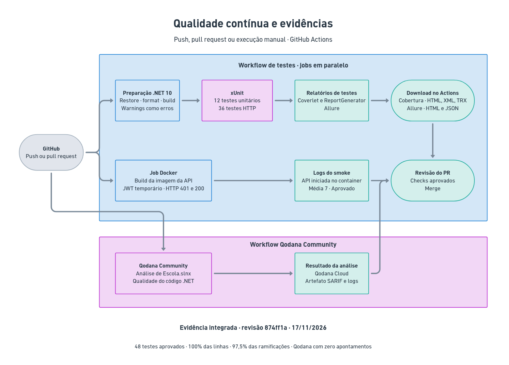

# FIAP 5NETT — Fase 3

API de resultado acadêmico desenvolvida para o Tech Challenge da **Pós Tech em Arquitetura de Sistemas .NET com Azure — FIAP 5NETT**. A aplicação calcula a média de duas provas e informa a situação do aluno, com autenticação JWT, documentação interativa e evidências de qualidade no GitHub Actions.

[](https://github.com/robertishimurasousa/Fiap-Pos-Tech-DotNet-Azure-Fase3/actions/workflows/dotnet-ci.yml)
[](https://github.com/robertishimurasousa/Fiap-Pos-Tech-DotNet-Azure-Fase3/actions/workflows/qodana_code_quality.yml)

[Arquitetura](#arquitetura) · [Executar localmente](#executar-localmente) · [Postman](#testar-no-postman) · [Testes](#executar-a-suíte) · [Relatórios e CI](#github-actions-e-evidência-para-a-fiap)

## Arquitetura

### Fluxo da API


O endpoint HTTP recebe as notas e traduz erros de validação em Problem Details. O `ResultadoAcademicoService` concentra a regra de cálculo e pode ser testado sem servidor HTTP. A configuração JWT valida a assinatura, o emissor, a audiência e a validade do token. O Scalar utiliza o contrato OpenAPI da própria API.

O recorte é um serviço síncrono, sem persistência ou dependências externas de negócio. A separação entre transporte, autenticação e regra de cálculo aplica os princípios de responsabilidade única e testabilidade vistos na Fase 3. A estrutura permanece proporcional ao tamanho da atividade.

### Fluxo de qualidade contínua



O workflow de testes executa dois jobs em paralelo: testes .NET com relatórios e smoke HTTP da API em Docker. O Qodana possui um workflow próprio para análise estática. Os resultados ficam associados à revisão executada no GitHub.

As imagens são exportações do [quadro editável no Whimsical](https://whimsical.com/9EyCCdUp52DCkLSi74foeV), que também preserva a tabela de cenários da regra de negócio. O acesso ao quadro depende de permissão no Whimsical; as imagens podem ser consultadas diretamente neste repositório.

## Regra de negócio e contrato HTTP

- As duas notas são obrigatórias e devem estar entre **0 e 10**, inclusive.
- A média tem pesos iguais: `(nota1 + nota2) / 2`.
- A comparação ocorre **sem arredondamento**. Média maior ou igual a **7** resulta em `Aprovado`; abaixo disso, `Reprovado`.

Por exemplo, `6` e `8` produzem média `7` e aprovação. Já `6.99` e `7.00` produzem média `6.995` e reprovação.

| Método e rota | Finalidade | Respostas principais | Acesso |
| --- | --- | --- | --- |
| `POST /auth/token` | Emitir JWT de demonstração a partir do campo `codigo` | `200` com token; `401` para código incorreto | Apenas Development |
| `POST /resultados-academicos/calcular` | Calcular a média e a situação | `200` com resultado; `400` para notas inválidas; `401` para token ausente ou inválido | Bearer JWT |
| `GET /scalar/v1` | Consultar e experimentar a API | `200` com documentação interativa | Apenas Development |
| `GET /openapi/v1.json` | Consultar o contrato OpenAPI | `200` com o documento JSON | Apenas Development |

Exemplo de entrada do cálculo:

```json
{"nota1": 6, "nota2": 8}
```

Resposta HTTP `200`:

```json
{"media": 7, "situacao": "Aprovado"}
```

## Executar localmente

Pré-requisitos: Docker com Compose **ou** SDK .NET 10, além de OpenSSL para o comando abaixo. O SDK compatível está definido em [`global.json`](global.json).

Crie o arquivo `.env` na raiz com dois valores aleatórios independentes. Execute este comando uma vez em um clone novo:

```sh
(umask 077; set -C; printf 'ESCOLA_JWT_CHAVE=%s\nESCOLA_JWT_CODIGO=%s\n' "$(openssl rand -hex 32)" "$(openssl rand -hex 32)" > .env)
```

O `.env` é local e está ignorado pelo Git. `ESCOLA_JWT_CHAVE` assina os tokens; `ESCOLA_JWT_CODIGO` permite obtê-los no ambiente educacional de demonstração. A emissão local fica disponível somente em Development.

### Com Docker Compose

```sh
docker compose up --build
```

O Compose inicia a API em Development e publica a porta 5080 no endereço local `127.0.0.1`. Os links da emissão de token, da API, do Scalar e do OpenAPI aparecem nos logs junto com o horário de início em São Paulo.

Para iniciar em outra porta, use `ESCOLA_PORTA_LOCAL=5081 docker compose up --build`. Para remover o container e a rede da aplicação, execute `docker compose down`.

### Com o SDK .NET

As duas opções usam a porta 5080. Encerre a primeira execução antes de iniciar a outra.

```sh
. ./.env
ASPNETCORE_ENVIRONMENT=Development \
  Jwt__ChaveAssinatura="$ESCOLA_JWT_CHAVE" \
  Jwt__CodigoAcesso="$ESCOLA_JWT_CODIGO" \
  dotnet run --project src/Escola.Api -- --urls http://127.0.0.1:5080
```

Em Development, abra o [Scalar](http://127.0.0.1:5080/scalar/v1) para consultar e testar a operação. O [documento OpenAPI](http://127.0.0.1:5080/openapi/v1.json) também está disponível.

### Autenticar e calcular

1. No Scalar, execute `POST /auth/token` com um JSON cujo campo `codigo` contém o valor de `ESCOLA_JWT_CODIGO` do arquivo `.env`.
2. Copie o `accessToken` da resposta para a autenticação Bearer do Scalar. O token dura 15 minutos. A emissão local só está disponível em Development.
3. Execute `POST /resultados-academicos/calcular` com as duas notas. Para usar o terminal, defina a variável `TOKEN` com o token emitido e rode:

```sh
curl -i http://127.0.0.1:5080/resultados-academicos/calcular \
  -H "Authorization: Bearer $TOKEN" \
  -H 'Content-Type: application/json' \
  -d '{"nota1":6,"nota2":8}'
```

O exemplo retorna HTTP `200` com média `7` e situação `Aprovado`. Com uma nota ausente ou fora de 0 a 10, a API retorna HTTP `400` com Problem Details. Um token ausente, inválido ou expirado recebe HTTP `401`.

## Testar no Postman

1. Inicie a API com `docker compose up --build`.
2. No Postman Desktop, clique em **Import** e selecione a [coleção](postman/fiap-5nett-fase-3.postman_collection.json) e o [ambiente](postman/fiap-5nett-local.postman_environment.json).
3. Selecione **FIAP 5NETT — Local**. Preencha o valor **local** de `codigoAcesso` com `ESCOLA_JWT_CODIGO` do `.env`. A `baseUrl` já aponta para a porta 5080. Se a API estiver em outra porta, ajuste também o valor local de `baseUrl`.
4. Envie **Obter token JWT**. O script guarda `accessToken` no ambiente, e as requisições protegidas usam esse valor automaticamente. Emita um novo token após 15 minutos.
5. Envie uma requisição de cálculo e confira **Test Results**. Para executar todos os casos, abra a coleção e escolha **Run collection** com o mesmo ambiente. Mantenha **Obter token JWT** como primeira requisição.

Para rodar a mesma coleção no terminal interno do Postman Desktop ou com o [Postman CLI independente](https://learning.postman.com/docs/postman-cli/postman-cli-installation), use Python 3.9+ na raiz:

```sh
python3 postman/run.py
python3 postman/run.py --porta 5081
```

O runner lê o código do `.env`, monta um ambiente temporário para o endereço local e o remove ao terminar. A chave de assinatura fica com a API.

## Executar a suíte

Na raiz do repositório, com o SDK .NET 10:

```sh
dotnet restore Escola.slnx
dotnet format Escola.slnx --verify-no-changes --no-restore
dotnet build Escola.slnx --configuration Release --no-restore -warnaserror
dotnet test Escola.slnx --configuration Release
```

Os testes configuram as próprias credenciais de demonstração. A suíte usa **xUnit** e cobre a regra de negócio, os contratos HTTP, a autenticação e a inicialização da aplicação. Os testes HTTP executam a API em memória com `WebApplicationFactory` e `TestServer`.

## GitHub Actions e evidência para a FIAP

O workflow [**Testes e cobertura .NET**](.github/workflows/dotnet-ci.yml) verifica a formatação C#, compila com warnings tratados como erros e executa as suítes xUnit unitária e HTTP. O job separado de Docker compila a imagem e verifica a resposta `401` sem token e o cálculo autenticado com resposta `200`, média `7` e situação `Aprovado`.

O workflow [**Qodana**](.github/workflows/qodana_code_quality.yml) analisa `Escola.slnx` com o linter Community para .NET. Ambos podem ser acionados por pushes em `main` ou `rob-*`, por pull requests e manualmente. As branches de trabalho seguem o identificador e o assunto da issue, como `rob-14-padronizacao-branches`. O Qodana também acompanha `releases/*` e envia a análise ao projeto configurado no Qodana Cloud.

### Relatórios para baixar

Abra uma execução em [Actions](https://github.com/robertishimurasousa/Fiap-Pos-Tech-DotNet-Azure-Fase3/actions) e consulte **Artifacts** no resumo:

| Artefato | Conteúdo | Como consultar |
| --- | --- | --- |
| `cobertura-dotnet` | HTML consolidado, XML Cobertura e resultados TRX | Extraia o ZIP e abra `coverage/index.html` |
| `relatorio-allure` | Relatório navegável e resultados JSON dos testes | Extraia o ZIP e abra `allure-report/index.html` |
| `qodana-report` | Resultado da análise estática, SARIF e logs | Baixe na execução do workflow Qodana ou consulte o Qodana Cloud |

O resumo da execução .NET também mostra a cobertura consolidada. Os logs do job **Smoke HTTP em Docker** registram a verificação da API no container.

O HTML do Allure é autocontido e mostra cenários, parâmetros, duração e resultado de cada teste. A pipeline também gera e publica o Allure quando uma suíte registra falhas.

Os cenários HTTP de resultado acadêmico apresentam as etapas de autenticação, envio e validação. Cada cenário anexa a entrada JSON e o corpo da resposta de cálculo ou Problem Details, junto com o status HTTP recebido.

### Referência validada

Resultados da revisão [`874ff1a`](https://github.com/robertishimurasousa/Fiap-Pos-Tech-DotNet-Azure-Fase3/commit/874ff1a44c771a7d8e054b0503fa21341f1f03ed), integrada em 17/11/2026:

| Evidência | Resultado | Link |
| --- | --- | --- |
| xUnit | 48 testes aprovados: 12 unitários e 36 HTTP | [Execução .NET](https://github.com/robertishimurasousa/Fiap-Pos-Tech-DotNet-Azure-Fase3/actions/runs/44176086976) |
| Cobertura | 100% das linhas e 97,5% das ramificações | [Download da cobertura](https://github.com/robertishimurasousa/Fiap-Pos-Tech-DotNet-Azure-Fase3/actions/runs/44176086976/artifacts/14370845741) |
| Allure | Cenários, etapas e anexos dos testes | [Download do Allure](https://github.com/robertishimurasousa/Fiap-Pos-Tech-DotNet-Azure-Fase3/actions/runs/44176086976/artifacts/14370451618) |
| Qodana | Zero apontamentos na análise executada | [Execução Qodana](https://github.com/robertishimurasousa/Fiap-Pos-Tech-DotNet-Azure-Fase3/actions/runs/44176087361) · [Download do relatório](https://github.com/robertishimurasousa/Fiap-Pos-Tech-DotNet-Azure-Fase3/actions/runs/44176087361/artifacts/14370860766) |

Os números são uma fotografia dessa revisão. Para alterações posteriores, consulte a execução correspondente. Os downloads do GitHub Actions exigem login e permanecem disponíveis durante a retenção dos artefatos.

### Gerar o Allure localmente

Com Node.js 24 instalado, remova a pasta gerada `allure-results` antes de repetir a execução. Na raiz, execute:

```sh
dotnet test Escola.slnx --configuration Release -- xUnit.ReporterSwitch=allure
npx --yes allure@3.33.0 generate --clean
```

Abra `allure-report/index.html` no navegador. A configuração do gerador está em `allurerc.json`, e `tests/allureConfig.json` direciona as duas suítes para `allure-results`. O pacote `Allure.Xunit` usa o runner xUnit 2.8.2 por compatibilidade com a descoberta de reporters.

## Organização do código

```text
src/Escola.Api/
  Autenticacao/            Configuração, validação e emissão local de JWT
  ResultadosAcademicos/   Regra de cálculo e contratos de entrada e saída
  Program.cs              Composição da aplicação, rotas e OpenAPI
tests/
  Escola.UnitTests/       Testes da regra de negócio
  Escola.IntegrationTests/ Testes HTTP, autenticação e inicialização
postman/                  Coleção, ambiente e runner local
scripts/                  Smoke HTTP da API no Docker
docs/images/              Exportações dos fluxos do Whimsical
.github/workflows/        Testes, cobertura, Allure, Docker e Qodana
```

## Demonstração em vídeo

O [roteiro e o acompanhamento da gravação estão na ROB-9](https://linear.app/deltaedgeai/issue/ROB-9), no Linear. A demonstração segue esta sequência:

1. Apresente o fluxo da API e a regra de resultado acadêmico.
2. No Postman, obtenha o token e execute os cenários de aprovação, reprovação, notas inválidas e acesso sem token.
3. Mostre os testes unitários e HTTP e a execução aprovada no GitHub Actions, incluindo o smoke em Docker.
4. Baixe a cobertura e apresente as linhas e ramificações cobertas.
5. Abra o Allure para mostrar os cenários, as etapas e os anexos. Apresente também a análise do Qodana.
6. Conecte a separação de responsabilidades, a testabilidade e a execução em container ao conteúdo da Fase 3.
